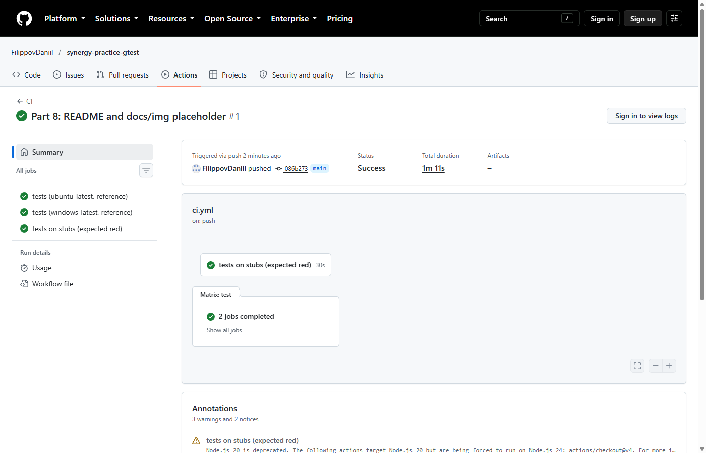
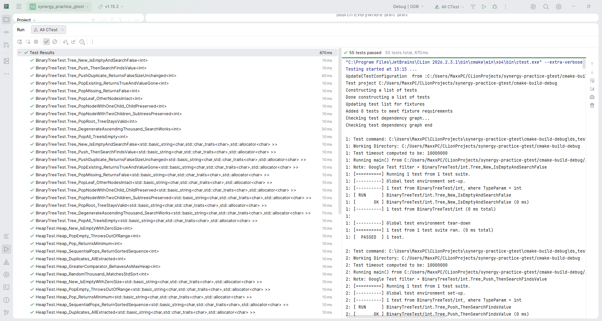
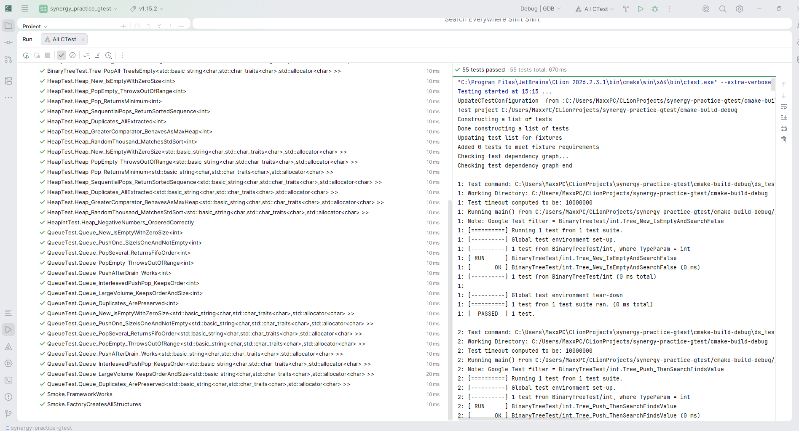
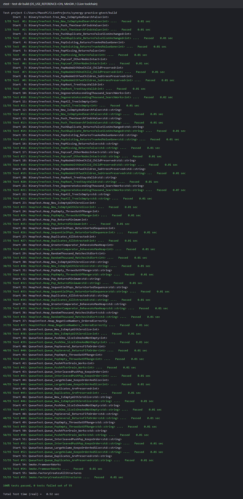
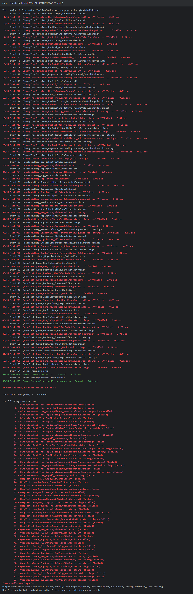

# synergy-practice-gtest

[](https://github.com/FilippovDaniil/synergy-practice-gtest/actions/workflows/ci.yml)

Кейс-задача № 4 учебной практики (Synergy): юнит-тесты на **googletest**.

## Задание

> Реализовать ряд юнит-тестов с использованием фреймворка googletest для каждого из следующих классов
> (сами процедуры реализовывать не нужно, только интерфейс):
> - Класса очереди (queue) с функциями pop, push
> - Класса кучи (heap) с функциями pop, push
> - Класса бинарного дерева с функциями pop, push, search

## Что сдаётся

| Часть | Где | Статус |
|-------|-----|--------|
| **Интерфейсы** (основная часть) | [`include/ds/`](include/ds) | абстрактные шаблонные классы, только `virtual … = 0`, контракт в doc-комментариях |
| **Юнит-тесты** (основная часть) | [`tests/`](tests) | работают **только через интерфейс** (указатель на базовый класс + фабрика) |
| Заглушки | [`src/stubs/`](src/stubs) | каждый метод бросает `std::logic_error("not implemented")` |
| Эталонная реализация | [`src/reference/`](src/reference) | **вспомогательная**, только чтобы доказать корректность тестов |

Реализация для тестов выбирается в [`tests/factory.hpp`](tests/factory.hpp) CMake-опцией `DS_USE_REFERENCE`:

| `DS_USE_REFERENCE` | Тесты гоняются на | Результат |
|--------------------|-------------------|-----------|
| `ON` (по умолчанию) | эталонной реализации | все зелёные |
| `OFF` | заглушках | красные — демонстрация TDD: тесты написаны до реализации |

## Интерфейсы

```cpp
namespace ds {

template <typename T>
class IQueue {                                   // FIFO
    virtual void push(const T& value) = 0;       // в конец
    virtual T pop() = 0;                         // из начала; пустая -> std::out_of_range
    virtual bool empty() const = 0;
    virtual std::size_t size() const = 0;
};

template <typename T, typename Compare = std::less<T>>
class IHeap {                                    // min-heap по Compare
    virtual void push(const T& value) = 0;
    virtual T pop() = 0;                         // извлечь минимум; пустая -> std::out_of_range
    virtual bool empty() const = 0;
    virtual std::size_t size() const = 0;
};

template <typename T>
class IBinaryTree {                              // BST без дубликатов
    virtual bool push(const T& value) = 0;       // false, если уже есть
    virtual bool pop(const T& value) = 0;        // false, если нет
    virtual bool search(const T& value) const = 0;
    virtual bool empty() const = 0;
    virtual std::size_t size() const = 0;
};

} // namespace ds
```

`empty()` / `size()` — вспомогательные методы для проверок; основные методы по заданию — `push` / `pop` / `search`.

## Тесты

Тесты типизированные (`TYPED_TEST`, типы `int` и `std::string`), на фикстурах. Имена — `Класс_Сценарий_Ожидание`.

| Класс | Сценарии | Тестов (с учётом типов) |
|-------|----------|-------------------------|
| Queue | новая пуста; push одного; FIFO; pop из пустой → `out_of_range`; push после опустошения; чередование push/pop; 10 000 элементов; дубликаты | 16 |
| Heap | новая пуста; pop из пустой → `out_of_range`; pop даёт минимум; сортированная выдача; дубликаты; отрицательные (`int`); `std::greater` → max-heap; 1 000 случайных vs `std::sort` | 15 |
| BinaryTree | новое пусто; push → search; дубликат → false; pop существующего; pop несуществующего; удаление листа / узла с одним потомком / с двумя потомками / корня; вырожденное дерево 1 000; pop всех → пусто | 22 |
| Smoke | фреймворк работает; фабрика создаёт все структуры | 2 |
| **Итого** | | **55** |

## Сборка и запуск

Требования: CMake ≥ 3.20, компилятор C++17 (GCC / Clang / MSVC). googletest `v1.15.2` скачивается автоматически через `FetchContent`.

```bash
cmake -S . -B build
```
```bash
cmake --build build
```
```bash
ctest --test-dir build --output-on-failure
```

Демонстрация TDD (тесты на заглушках — должны падать):

```bash
cmake -S . -B build-stub -DDS_USE_REFERENCE=OFF
```
```bash
cmake --build build-stub
```
```bash
ctest --test-dir build-stub --output-on-failure
```

В CLion: открыть папку проекта → CMake подхватится автоматически → запустить конфигурацию `ds_tests` (Test Runner покажет дерево тестов).

## Результаты

| Режим | Результат |
|-------|-----------|
| `DS_USE_REFERENCE=ON` | `100% tests passed, 0 tests failed out of 55` |
| `DS_USE_REFERENCE=OFF` | `4% tests passed, 53 tests failed out of 55` (зелёные только smoke-тесты) |

CI ([`.github/workflows/ci.yml`](.github/workflows/ci.yml)): сборка и тесты на `ubuntu-latest` и `windows-latest`, плюс отдельный джоб, который **проверяет, что на заглушках тесты падают**.

### Скриншоты

**GitHub Actions** — все джобы зелёные (ubuntu, windows, проверка «на заглушках тесты падают»):



**CLion Test Runner** — 55 из 55 тестов пройдено (дерево тестов, две части):





**Эталон (`DS_USE_REFERENCE=ON`), консоль `ctest`** — 55 из 55 тестов пройдено:



**Заглушки (`DS_USE_REFERENCE=OFF`)** — 53 из 55 тестов падают (TDD, red):



## Структура

```
synergy-practice-gtest/
├─ CMakeLists.txt
├─ include/ds/          queue.hpp, heap.hpp, binary_tree.hpp   — интерфейсы
├─ src/stubs/           stubs.hpp                              — заглушки
├─ src/reference/       reference.hpp                          — эталон (вспомогательный)
├─ tests/               *_test.cpp, factory.hpp, test_values.hpp
├─ docs/img/            скриншоты
└─ .github/workflows/   ci.yml
```
